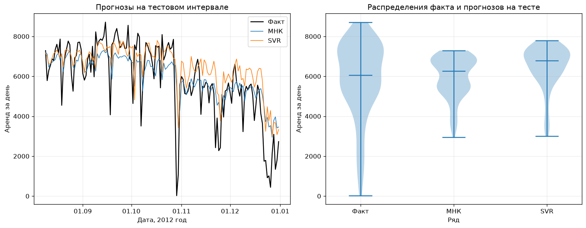
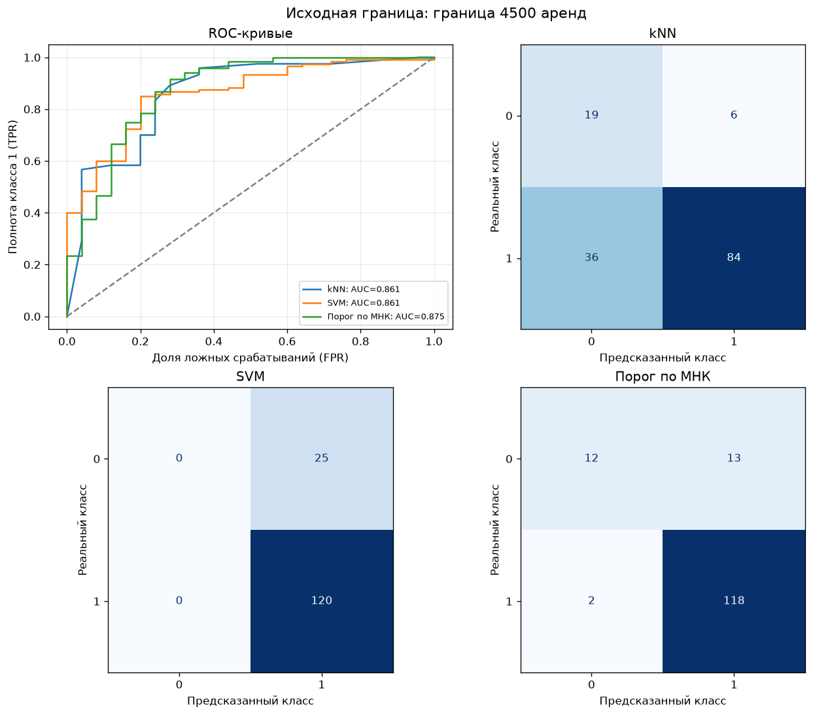

# Прогнозирование спроса на аренду велосипедов

Учебный аналитический проект: исследование ежедневной статистики велопроката Capital Bikeshare (Вашингтон, 2011–2012), прогноз количества аренд на следующий день и сравнение подходов к определению дней высокого спроса.

📓 **Ноутбук с решением:** [`solution3.ipynb`](solution3.ipynb)



## Ключевые результаты

| Что | Результат |
|---|---|
| Прогноз аренд на следующий день | Линейная регрессия: **RMSE 1223** против 1291 у базового прогноза «как вчера» (**−5,2%**) |
| Классификация дней высокого спроса (порог 4500 аренд) | Классификация по прогнозу регрессии: **Accuracy 89,7%, F1 0,940** (130 из 145 тестовых дней) |
| Найденная проблема | SVM отнесла все тестовые дни к одному классу при внешне высокой Accuracy. Это видно по матрице ошибок и отражено в выводах |

## Постановка задачи

Сервису проката важно заранее знать, сколько велосипедов понадобится завтра, чтобы планировать распределение парка и обслуживание. В проекте две задачи:

1. **Регрессия:** спрогнозировать количество аренд на следующий день.
2. **Классификация:** определить, будет ли день днём высокого спроса (количество аренд выше порога).

## Данные

[`day.csv`](day.csv) из [Bike Sharing in Washington D.C. Dataset](https://www.kaggle.com/datasets/marklvl/bike-sharing-dataset) (Kaggle): 731 день, 16 столбцов — дата, сезон, календарные признаки, погода, число аренд зарегистрированных и незарегистрированных пользователей. Файл сохранён без изменений.

## Ход работы

**1. Проверка качества данных**
- пропуски, дубликаты, повторные и пропущенные даты;
- допустимость значений;
- согласованность показателей: общее число аренд = зарегистрированные + незарегистрированные.

**2. Подготовка признаков**
- календарные признаки и сезонность;
- лаги: аренды за предыдущий день и неделю, скользящее среднее за 7 дней;
- погода предыдущего дня.

**3. Защита от утечки данных.** Исключены фактическая погода прогнозируемого дня и показатели, из которых напрямую складывается целевая переменная.

**4. Хронологическое разделение** на обучение, валидацию и тест (724 наблюдения после подготовки признаков, 145 — итоговый тест). Гиперпараметры подбирались только на валидации.

**5. Модели и метрики**
- регрессия: линейная регрессия и SVR; метрики MAE, RMSE, MAPE, MASE; сравнение с прогнозом «как вчера»;
- классификация: kNN, SVM и классификация по результату регрессии; метрики Accuracy, F1, LogLoss, ROC AUC; ROC-кривые и матрицы ошибок;
- дополнительный эксперимент: порог, дающий соотношение классов около 80/20, и его влияние на результаты.



## Ограничения и выводы

- Дни с очень низким спросом сильно завышают относительную ошибку (MAPE), поэтому её стоит смотреть вместе с MAE, RMSE и MASE.
- Распределения в обучающем и тестовом периодах различаются: спрос растёт от года к году.
- Accuracy сама по себе недостаточна для оценки классификатора: модель, предсказывающая один класс, может выглядеть хорошо по Accuracy и быть бесполезной.

## Запуск

```bash
pip install -r ../requirements.txt
jupyter notebook solution3.ipynb
```

## Стек

Python · pandas · NumPy · scikit-learn · SciPy · Matplotlib · Jupyter Notebook
